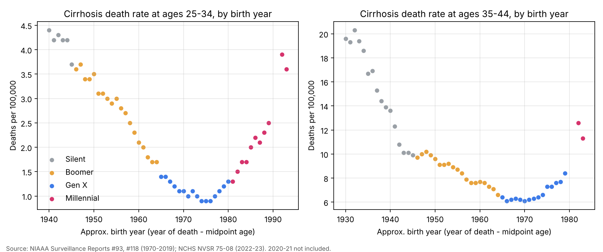

# Millennial Alcohol-Related Mortality: A Generational Cohort Analysis

**Do millennials die of alcohol-related liver disease more than past generations did at the same age?**

Using 50+ years of public U.S. mortality data (1970–2023), this project lines up liver cirrhosis death rates by birth year to compare the Silent Generation, Boomers, Gen X, and millennials at the same ages.



## Key findings

| Age | Silent | Boomer | Gen X | Millennial |
|---|---|---|---|---|
| 25–34 | 4.2 | 2.8 | 1.1 | 2.3 (3.6–3.9 in 2022–23) |
| 35–44 | 15.1 | 8.5 | 6.7 | 12.0 |

*Mean deaths per 100,000 across the years each generation occupied that age band.*

- **Millennials vs. Gen X:** at ages 25–34, millennials' cirrhosis death rate is about **2.4×** Gen X's at the same age.
- **Not a record:** the Silent Generation's rates were higher. The long-run pattern is a **U shape**: decades of improvement, a low point with Gen X, then a reversal starting with people born after ~1975.
- **Period + cohort effects:** since 2000–04, rates rose 20–70% for older age groups but about **250%** for 25–34-year-olds.

## Method

1. Compiled age-specific cirrhosis death rates from NIAAA and NCHS reports ([sources](data/SOURCES.md)).
2. Estimated birth year as *year of death − midpoint of the 10-year age band*.
3. Assigned generations (Silent ≤1945, Boomer 1946–64, Gen X 1965–80, Millennial 1981–96).
4. Compared mean rates by generation within each age band, and checked how much each age band changed vs. a 2000–04 baseline.

Cirrhosis is used as a proxy for heavy-drinking mortality because consistent age-specific "alcohol-induced death" series only begin in 1999.

## Limitations

- Cirrhosis has non-alcohol causes (hepatitis B/C, fatty liver disease); older cohorts' higher hepatitis C rates likely inflate their numbers somewhat.
- 2020–2021 data are not included.
- 2022–2023 values come from NCHS; definitions are close to NIAAA's but not identical.
- Birth years are approximate and generation cutoffs are conventions.
- The analysis is descriptive. It shows **when** rates changed, not **why**, and does not test causes such as advertising, the 2008 recession, or obesity.

## Repo structure

```
data/        cirrhosis_rates_by_age_1970_2023.csv, SOURCES.md
notebooks/   cohort_analysis.ipynb  (full analysis, executed)
figures/     cohort_chart.png
```

## Run it

```bash
pip install -r requirements.txt
jupyter notebook notebooks/cohort_analysis.ipynb
```

## Data & license

Data are U.S. government works (NIAAA, CDC/NCHS) in the public domain. Code is released under the MIT License.

---
*Author: Ayebi Marc Antoine Atsin*
